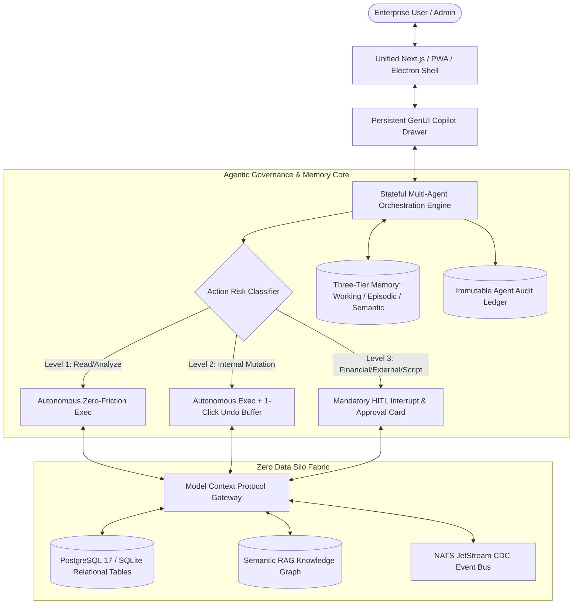

# 🏛️ AegisOS System Architecture & Engineering Blueprint

> **Complete Technical Specification for Replicating Zoho Enterprise (Zoho One)**  
> **Document Reference**: RFP v3.0 Master Edition  
> **Author**: Prerna Chotwani (Chief AI Architect & Pod Lead)  

---

## 1. High-Level Architectural Paradigm

AegisOS transitions enterprise software from a **passive data-entry silo** to an **active, autonomous Agentic Operating System**. Instead of human operators navigating 40+ disconnected menus, 26 specialized AI agents interact over a unified PostgreSQL relational + vector data fabric and an event-driven CDC (Change Data Capture) message bus.

---

## 2. Three-Tier Agent Memory Architecture (Section 3.2)

To prevent hallucinations, context bloat, and session drift, AegisOS implements a three-tier memory architecture:

### Tier 1: Working Memory (Short-Term Context)
- **Engine**: In-Memory / Redis session cache.
- **Scope**: Tracks the active conversation state, authenticated user persona (`usr_admin`), current module view (`crm`, `finance`, etc.), and uncommitted input drafts.
- **TTL**: Active session or hot tab reload.

### Tier 2: Episodic Memory (Interaction History)
- **Engine**: Indexed relational history (`agent_memory` where `tier = 'episodic'`).
- **Scope**: Captures all past agent invocations, human feedback, prompt corrections, and HITL approval outcomes per user and department.
- **Use Case**: Allows agents to recall past negotiations (e.g. *"Nordic Logistics previously requested a 12% rebate and was approved by the VP Sales"*).

### Tier 3: Semantic Memory (Enterprise Knowledge Graph / RAG)
- **Engine**: Hybrid vector embeddings + multi-token full-text search.
- **Scope**: Continuously ingests company travel policies, SOC 2 compliance documents, SLA agreements, and resolved customer support tickets.
- **Permissions**: Enforces department-level RBAC chunk filtering before context injection.

---

## 3. Action Risk Classification & HITL Matrix (Section 3.2)

Every action proposed by any of the 26 autonomous agents is strictly evaluated through a three-level risk matrix before execution:

| Risk Tier | Classification | Definition | Safety Guardrail | Example Invocations |
| :--- | :--- | :--- | :--- | :--- |
| **Level 1** | **Read / Analyze** | Non-mutating data queries, summarization, drafting, and analytical forecasts. | **Autonomous (Zero Friction)**: Executes immediately; logged to audit ledger. | - Scrape firmographics & rank ICP - Monte Carlo pipeline velocity forecast - Natural Language to SQL analytics |
| **Level 2** | **Internal Mutations** | Changes state within internal databases without external exposure or irreversible financial consequences. | **Autonomous with 1-Click Undo**: Executes automatically; displays a 10-second interactive revert notification. | - Update CRM deal stages - Assign support ticket priority - Draft omnichannel marketing campaigns - Balance Agile sprint story points |
| **Level 3** | **External / Financial / Script Mutations** | Direct financial impact, external client communications, payroll changes, or code/script execution on hosts. | **Mandatory HITL Approval**: Pauses execution graph; streams an interactive Approval Card to Copilot drawer. Execution blocked until human sign-off. | - Approve quote discount > 10% - Issue customer refund > $50 - Execute shell cleanup script on managed endpoint - Issue corporate SSO credentials |

---

## 4. Immutable Agent Audit Ledger (Section 3.2)

Every single agent execution records the following telemetry:
- `id`: Globally unique invocation identifier (e.g. `aud-9a2f1b4c`)
- `timestamp`: High-precision ISO 8601 execution time
- `agent_id`: Machine name of the agent
- `on_behalf_of_user_id`: Authenticated user or service account initiating the trigger
- `trigger_event`: Cause of execution (e.g. `lead.created`, `deal.closed_won`, `user.copilot_prompt`)
- `prompt_hash`: Cryptographic SHA-256 hash of prompt input
- `reasoning_trace`: Step-by-step chain-of-thought rationale
- `mcp_tools_called`: Standardized Model Context Protocol tools executed
- `before_after_diff`: Structured JSON diff of database state mutations
- `token_cost`: Calculated token expense in USD based on model inference rates
- `approval_status`: `Autonomous`, `Pending_HITL`, `Approved`, `Rejected`, or `Reverted`

---

## 5. Model Context Protocol (MCP) Standard Server (Section 3.1)

AegisOS adheres to the **Model Context Protocol (MCP)** specification. All business logic across the 9 module groups is exposed as standardized MCP tools:

- `mcp::enrich_lead`: Scrapes company revenue, headcounts, tech stack.
- `mcp::calculate_cpq_margin`: Validates price books, volume tiers, gross margins.
- `mcp::create_documenso_envelope`: Prepares cryptographic digital signature workflows.
- `mcp::search_kb_rag`: Queries hybrid vector semantic memory.
- `mcp::ocr_receipt_image`: Forensic receipt extraction and policy auditing.
- `mcp::execute_endpoint_remediation`: Managed endpoint diagnostics and repair.
- `mcp::translate_nl_to_sql`: Converts plain English inquiries to validated SQL.
- `mcp::generate_n8n_flow`: Generates multi-step event automations.

---

## 6. AI-Accelerated Engineering Pod Mandate (Section 3.3)

To deliver enterprise-grade depth without a bloated 200-engineer payroll, the architecture adheres to a lean 4-engineer pod model:

1. **Principal AI & Agent Architect (Pod Lead - Prerna Chotwani)**:
   - Owns multi-agent graph execution, MCP tool schemas, LiteLLM gateway, RAG pipeline, and HITL safety boundaries.
2. **Lead Platform & Data Engineer**:
   - Owns unified database schemas, NATS JetStream event bus, Keycloak SSO, and Docker/Kubernetes IaC.
3. **Lead Product & GenUI Engineer**:
   - Owns the single-pane app shell, Linear-inspired design system, persistent Copilot drawer, and interactive GenUI component streaming.
4. **Full-Stack Integration & AI QA Engineer**:
   - Owns iPaaS workflow automations, third-party REST connectors, automated Playwright E2E suites, and LLM-as-a-judge regression tests.
