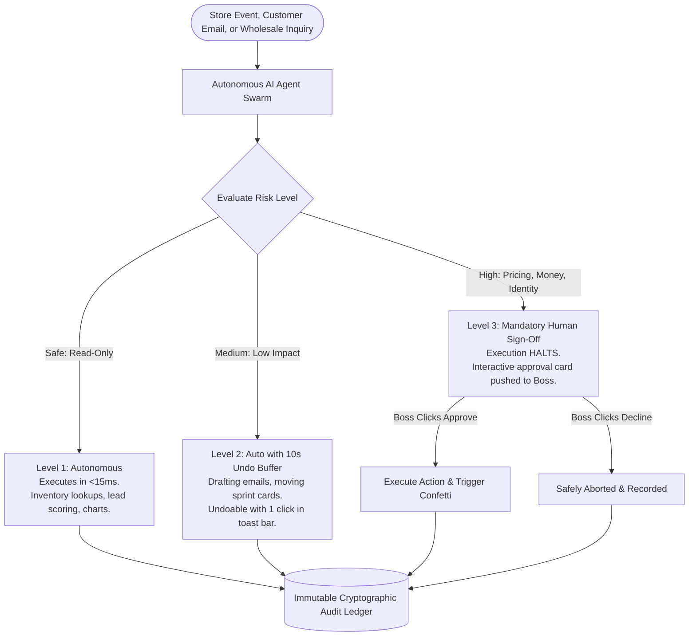

# 🛍️ AegisWear OS: Project Explainer & Complete Architecture Guide

> **Project Name**: AegisWear (AI-Native Fashion & E-Commerce Operating System)  
> **Architecture & Creative Lead**: Prerna Chotwani  
> **Brand & Design Aesthetic**: Setproduct Clayshop Pastel Claymorphism (Zero Emojis, Crisp Vector SVG Iconography)  
> **Platform Support**: Desktop Web, Mobile Phones & Tablets (Touch-Optimized), and Installable PWA Desktop App  
> **Core Architecture**: 26 Autonomous AI Agents, 9 Department Rooms (A–I), Three-Tier Risk Matrix (Level 1/2/3 HITL), Dynamic Store Assistant, and Model Context Protocol (MCP)  

---

## 1. Explain Like I'm 10: What Does This Project Do?

### 📖 The Story of AegisWear
Imagine you and your friends start an exciting boutique clothing brand called **AegisWear**.  
You design pastel sneakers (**Puffy Runners**), heavyweight soft hoodies (**Clay Hoodies**), organic cotton caps, tote bags, and summer sunglasses!

At first, you sell 5 items a day from your living room. It's easy and fun.  
Suddenly, your brand goes viral on Instagram! Thousands of customers order online, and high-end fashion boutiques in **Copenhagen, London, Tokyo, and Soho New York** want to order **500 pairs of sneakers at once ($65,000 orders)**!

### 😫 The Nightmare Problem (Why Normal Companies Break Down)
Normally, running a rapidly growing enterprise clothing brand is a logistical nightmare because founders are forced to juggle 10+ disjointed software applications (such as **Zoho One** or **Salesforce**):
1. **Wholesale Boutique Deals (Zoho CRM / Bigin)**: Copying boutique phone numbers and typing emails one by one.
2. **Warehouse Stock & Boxes (Zoho Inventory)**: Counting shoe boxes in warehouses and accidentally running out of size Medium.
3. **Supplier Invoices & Bills (Zoho Books / Expense)**: Typing fabric and zipper receipts into tax spreadsheets.
4. **Customer Sizing Complaints (Zoho Desk / SalesIQ)**: Answering hundreds of emails: *"Can I swap my Medium hoodie for a Large?"* or *"Where is my package?!"*
5. **Instagram & Email Drops (Zoho Campaigns / Social)**: Scheduling product launch sequences manually.
6. **Store iPads & Barcode Scanners (ServiceDesk Plus / Endpoint Central)**: Fixing frozen cash register iPads at retail popups.

Because these apps are separate silos, humans spend all day **copying, pasting, and reconciling numbers**. People get burnt out, inventory counts desync, customers get upset, and companies lose money!

---

### 🚀 The Magic Solution: AegisWear OS
**AegisWear replaces those 10 disjointed Zoho products with ONE unified, pastel clay operating system run by 26 specialized autonomous AI Agents!**

Instead of humans doing exhausting data entry:
- **Instant Size Swaps**: When a customer emails: *"I need to swap my Medium hoodie for a Large"*, **Agent 8 (Customer Support)** verifies warehouse stock, creates a prepaid return label, and replies in **under 60 seconds** without bothering a human.
- **Stock Depletion Forecasting**: When warehouse stock of **Puffy Runner Sneakers** drops to 18 pairs, **Agent 13 (Inventory Forecast)** alerts the factory and queues an automated reorder before sizes run out.
- **Plain English Business Intelligence**: When the founder asks: *"Show revenue breakdown by apparel category"*, **Agent 25 (Data Scientist)** translates English into SQL and renders a visual breakdown chart in **10 milliseconds**.

---

## 2. Safety First: The Three-Tier Risk Matrix (How The Boss Stays In Control)

What if an AI makes a catastrophic mistake, like granting an unauthorized 50% discount or wiping a customer database?  
AegisWear enforces strict **Three-Tier Risk Matrix Governance**:



### The 3 Safety Tiers Explained:
* **Level 1 — Autonomous Execution (Read-Only & Analytical):**  
  *Examples*: Scoring a prospective boutique (ICP 0–100), running inventory depletion simulations, querying order statuses, translating English questions to SQL.  
  *Execution*: Instantaneous (sub-15ms), completely safe.
* **Level 2 — Autonomous Execution with 1-Click Undo Buffer:**  
  *Examples*: Drafting wholesale outreach emails, staging social media drops, compiling daily standup digests.  
  *Execution*: Executes immediately, but holds a **10-second undo buffer**. A floating pastel toast bar lets the user cancel the action with a single tap.
* **Level 3 — Mandatory Human-in-the-Loop (HITL) Sign-Off:**  
  *Strict Guardrails*:  
  - Wholesale discounts greater than **10.0%** (e.g. Soho Fashion House asking for **15.0% off** a $65,000 sneaker order).  
  - Any deal that reduces gross profit margin below **35.0%**.  
  - Customer refunds exceeding **$50.00**.  
  - Running remote scripts or OS wipe commands on store iPad terminals.  
  *Execution*: **The agent HALTS execution immediately.** It pushes an interactive approval card to the Store Assistant drawer. **Zero money moves and zero contracts are sent until the Human Boss clicks "Approve Action"!**

---

## 3. Dynamic Store Assistant & Mobile Phone Optimization

### 🧠 Dynamic, Room-Aware Suggestions Engine
The Store Assistant (`#copilot-drawer`) is fully dynamic:
1. **Context-Aware Recommendations**: Suggestions automatically adapt to whatever room you are browsing:
   - In **Wholesale & Boutiques** (`crm`): Focuses on wholesale pricing, CPQ margins, and boutique scoring.
   - In **Warehouse & Inventory** (`finance`): Focuses on Puffy Runner sneaker restocks, YKK zipper invoices, and safety stock.
   - In **Returns & Customer Care** (`support`): Focuses on size exchange auto-resolution and delivery tracking.
   - In **Drops & Marketing** (`marketing`): Focuses on Instagram sentiment, summer capsule emails, and VIP early access.
   - In **Sales Trends** (`analytics`): Focuses on category gross margins, D2C vs wholesale split, and demand forecasts.
2. **Category Filter Chips**: Tapping **Check Stock**, **Wholesale Deals**, **Sales Trends**, **Customer Help**, or **Drops & Ads** instantly re-populates the suggestion cards for that specific workflow.
3. **Squishy "Shuffle Suggestions"**: A pastel shuffle button with a refresh icon smoothly rotates through the action pool for fresh ideas anytime.
4. **Live Priority Alert for Pending Approvals**: If an order needs boss sign-off, an urgent coral card appears at the top of the assistant prompt suggestions.
5. **Smart Follow-Up Action Pills**: After answering any query, the assistant renders 2–3 contextual **Next Suggested Actions** pills so you can proceed without typing.

### 📱 Perfect Mobile Phone Experience
AegisWear is optimized for smartphones (iOS & Android):
1. **Slide-Out Mobile Drawer**: On screen widths `<= 768px`, the left sidebar converts into an off-canvas slide-out drawer with a backdrop blur and touch dismiss.
2. **Mobile Header**: Displays a squishy hamburger button, a mint `AegisWear` pill, theme toggle, and assistant access.
3. **Thumb-Friendly Mobile Bottom Dock**: 4 persistent tabs fixed to the bottom:
   - **Store**: Overview dashboard.
   - **Rooms**: Quick drawer menu to jump to any of the 9 departments.
   - **Approvals**: Real-time coral badge counter showing pending approvals.
   - **Assistant**: One-tap slide-in of the Store Assistant drawer.
4. **Full-Width Assistant Sheet**: On mobile, the assistant drawer expands to full screen width (`100vw`) with keyboard safe-area insets (`env(safe-area-inset-bottom)`).
5. **Responsive Fluid Grids**: Stat cards and department rooms automatically stack into responsive 2-column or 1-column layouts with comfortable touch padding.

---

## 4. Tour of the 9 Fashion Department Rooms

| Room | Department Name | Real Fashion Workflow | Zoho One Product Replaced |
| :---: | :--- | :--- | :--- |
| **Room A** | **Wholesale & Boutiques** | Scores retail boutiques (0-100), drafts wholesale lookbooks, plans rep driving routes, and prepares Documenso digital contracts. | Zoho CRM, Bigin, RouteIQ, Zoho Sign |
| **Room B** | **Marketing & Campaigns** | Generates summer drop email drips, monitors Instagram sentiment, and detects rage clicks on the checkout funnel. | Zoho Campaigns, Marketing Plus, Social, PageSense |
| **Room C** | **Returns & Customer Care** | Resolves hoodie/sneaker size swaps in under 60 seconds, generates prepaid shipping labels, and drafts sizing FAQs. | Zoho Desk, SalesIQ, Assist |
| **Room D** | **Warehouse & Inventory** | Tracks depletion velocity for Puffy Runners, scans fabric supplier receipts with camera OCR, and reconciles Stripe payouts. | Zoho Books, Inventory, Expense |
| **Room E** | **Design Team & Staff** | Manages store employee shifts and vacation time (PTO), screens fashion designer portfolio resumes, and provisions SSO accounts. | Zoho People, Recruit |
| **Room F** | **Design Studio & Chat** | Triages wholesale buyer inquiries, transcribes lookbook calls, extracts fabric contract clauses, and stores passwords securely. | Zoho Mail, Cliq, Meeting, Writer, Vault |
| **Room G** | **Collection Launches** | Decomposes moodboards into production sprints, calculates critical path delays, and compiles async standup digests. | Zoho Projects, Sprints, BugTracker |
| **Room H** | **Store Registers & POS** | Monitors flagship store checkout iPads and barcode scanners, alerts on battery wear, and remotely locks lost hardware. | ServiceDesk Plus, Endpoint Central |
| **Room I** | **Sales Trends & Insights** | Translates natural English questions into SQL, draws category margin charts, and builds custom multi-step event automations. | Zoho Analytics, Creator, Flow |

---

## 5. Master Catalog: The 26 Autonomous Enterprise AI Agents

All 26 agents are active in the unified SQLite database fabric and audited in the immutable event ledger:

| # | Agent Identifier | Module Group | Zoho Replacement | Risk Tier | Primary MCP Tool | Default Model |
| :-: | :--- | :--- | :--- | :-: | :--- | :--- |
| **1** | `agent-lead-enrichment` | A: Sales & CRM | Zoho CRM / Zia Enrichment | Level 1 | `mcp::enrich_lead` | Gemini 2.0 Flash |
| **2** | `agent-sdr` | A: Sales & CRM | Zoho Bigin / Cadence | Level 2 | `mcp::draft_outreach_email` | Claude 3.5 Sonnet |
| **3** | `agent-deal-desk` | A: Sales & CRM | Zoho CPQ / Zoho Sign | **Level 3 (HITL)** | `mcp::calculate_cpq_margin` | Claude 3.5 Sonnet / GPT-4o |
| **4** | `agent-pipeline-forecast` | A: Sales & CRM | Zoho RouteIQ / Forecast | Level 1 | `mcp::run_monte_carlo_forecast` | Gemini 2.0 Flash |
| **5** | `agent-campaign-orchestrator` | B: Marketing & CX | Zoho Campaigns / Marketing Plus | Level 2 | `mcp::generate_email_sequence` | Claude 3.5 Sonnet |
| **6** | `agent-cro-analyst` | B: Marketing & CX | Zoho PageSense | Level 1 | `mcp::analyze_conversion_funnel` | Gemini 2.0 Flash |
| **7** | `agent-social-listening` | B: Marketing & CX | Zoho Social | Level 2 | `mcp::analyze_social_sentiment` | Gemini 2.0 Flash |
| **8** | `agent-tier1-2-resolution` | C: Support & Service | Zoho Desk / SalesIQ Bot | Level 2 / 3 | `mcp::search_kb_rag` | Claude 3.5 Sonnet |
| **9** | `agent-sentiment-churn` | C: Support & Service | Zoho Desk Sentiment / Zia | Level 2 | `mcp::evaluate_ticket_sentiment` | Gemini 2.0 Flash |
| **10** | `agent-auto-kb` | C: Support & Service | Zoho Desk Knowledge Base | Level 2 | `mcp::synthesize_ticket_resolution` | Gemini 2.0 Flash |
| **11** | `agent-bookkeeper` | D: Finance & ERP | Zoho Books / Banking | Level 2 | `mcp::fetch_bank_transactions` | Claude 3.5 Sonnet |
| **12** | `agent-receipt-ocr` | D: Finance & ERP | Zoho Expense | Level 2 / 3 | `mcp::ocr_receipt_image` | Gemini 2.0 Flash |
| **13** | `agent-inventory-forecast` | D: Finance & ERP | Zoho Inventory | Level 1 | `mcp::forecast_sku_depletion` | Gemini 2.0 Flash |
| **14** | `agent-ai-recruiter` | E: HR & Workplace | Zoho Recruit | Level 1 | `mcp::parse_resume_pdf` | Claude 3.5 Sonnet |
| **15** | `agent-hr-concierge` | E: HR & Workplace | Zoho People | Level 2 | `mcp::query_hr_policy_rag` | Gemini 2.0 Flash |
| **16** | `agent-onboarding-provisioning` | E: HR & Workplace | Zoho People Onboarding | **Level 3 (HITL)** | `mcp::provision_sso_identity` | Claude 3.5 Sonnet |
| **17** | `agent-meeting-scribe` | F: Collaboration | Zoho Meeting / Cliq | Level 2 | `mcp::summarize_transcript` | Claude 3.5 Sonnet |
| **18** | `agent-inbox-triage` | F: Collaboration | Zoho Mail / Streams | Level 2 | `mcp::classify_email_priority` | Gemini 2.0 Flash |
| **19** | `agent-document-synthesis` | F: Collaboration | Zoho Writer / WorkDrive | Level 1 | `mcp::summarize_long_document` | Gemini 2.0 Flash |
| **20** | `agent-scrum-master` | G: Project Management | Zoho Projects / Sprints | Level 2 | `mcp::decompose_prd_to_stories` | Claude 3.5 Sonnet |
| **21** | `agent-blocker-slippage` | G: Project Management | Zoho BugTracker / Gantt | Level 1 | `mcp::calculate_critical_path` | Gemini 2.0 Flash |
| **22** | `agent-standup-digest` | G: Project Management | Zoho Sprints Standup | Level 1 | `mcp::gather_async_updates` | Gemini 2.0 Flash |
| **23** | `agent-it-helpdesk` | H: ITSM & MDM | ServiceDesk Plus / Endpoint Central | **Level 3 (HITL)** | `mcp::query_fleet_telemetry` | Claude 3.5 Sonnet |
| **24** | `agent-license-optimizer` | H: ITSM & MDM | ServiceDesk Asset Manager | Level 2 | `mcp::audit_saas_usage` | Gemini 2.0 Flash |
| **25** | `agent-data-scientist` | I: BI & Low-Code | Zoho Analytics / Zia Insights | Level 1 | `mcp::translate_nl_to_sql` | Claude 3.5 Sonnet |
| **26** | `agent-workflow-builder` | I: BI & Low-Code | Zoho Flow / Creator | Level 2 | `mcp::generate_n8n_flow` | Claude 3.5 Sonnet |

---

## 6. How to Demonstrate the Project in 5 Minutes (Demo Script)

Follow this step-by-step walkthrough to present the platform:

### Step 1: Tour the Store Headquarters (Home Overview)
1. Open **`http://localhost:3000`** in Chrome, Edge, or Safari.
2. Note the **Setproduct Clayshop pastel claymorphic aesthetic**: dual inset highlights, rounded pills, squishy 3D buttons, and zero emojis.
3. Observe the **Live Store Ticker** cycling dynamic store updates every 5 seconds.
4. Show the **4 Quick Stat Cards**:
   - **Total Revenue ($50,500)**: Reconciled wholesale boutique and online orders.
   - **Orders Fulfilled (1,420 Orders)**: Dispatched hoodies, sneakers, and accessories.
   - **Orders Needing Review (2 Pending)**: Active Level 3 safety guardrails protecting margins.
   - **Customer Satisfaction (99.4% Positive)**: Automated size exchanges and customer care.

### Step 2: Test Level 3 Boss Approval Flow (The Core Safety Feature)
1. Click the coral **Store Assistant** button in the header or the **Approvals** tab in the mobile dock.
2. Locate the pending approval card:  
   *`Soho Fashion House requested a 15.0% discount on 500 Puffy Runner sneakers ($65,000 order)`*.  
   *Standard discount ceiling is 10.0%. Projected gross margin is 31.8% (below 35% safe limit).*
3. Explain: *"The AI refuses to process the discount autonomously because it violates policy. It holds execution and pushes an approval card to the Store Manager."*
4. Click **`Approve Action`**:
   - The buttons immediately lock into a permanent confirmed banner: `Order Action Approved & Dispatched by Prerna Chotwani`.
   - Celebratory pastel confetti launches across the screen (zero emojis).
   - An assistant confirmation is appended to the chat thread.
   - The pending approval badge decrements instantly.

### Step 3: Experience the Dynamic Suggestions & Follow-Up Pills
1. Inside the Store Assistant drawer, tap the **Wholesale Deals** category chip:
   - Notice how the suggestion cards instantly shift to wholesale pricing and boutique lookbook prompts.
2. Tap the **Shuffle** button:
   - Notice how 3 fresh options rotate into view smoothly.
3. Tap **"Check restock dates for Puffy Runner sneakers"**:
   - The assistant queries inventory velocity, answers in plain English, and provides **Next Suggested Actions** pills (`Order 50 replacement pairs from supplier`, `View warehouse stock across hubs`, `Notify Soho account manager`).

### Step 4: Test Customer Size Swaps (Room C: Returns & Customer Care)
1. Click **Returns & Customer Care** in the left sidebar or mobile drawer.
2. Locate Ticket `#AW-8921`: *"Customer received Medium Clay Hoodie, requests swap to Large"*.
3. Click **`Auto-Solve Size Exchange`**:
   - Agent 8 queries stock, reserves a Large hoodie, generates a prepaid return tracking label, and logs the exchange in under 1 second.

### Step 5: Test Natural Language to SQL (Room I: Sales Trends & Insights)
1. Click **Sales Trends & Insights** in the sidebar.
2. In the query box, click **`Show best-selling apparel categories and revenue`**:
   - Agent 25 translates the natural English into parameterized SQL (`SELECT category, SUM(revenue)...`), executes it against the relational database, and renders a live breakdown chart.

### Step 6: Test Mobile Phone Responsiveness
1. Shrink the browser window to mobile width (or open Chrome DevTools Device Mode for iPhone 14/15).
2. Observe the **Mobile Header** with squishy hamburger button and mint brand pill.
3. Tap the hamburger button to slide out the **Mobile Drawer** with smooth backdrop blur.
4. Tap the **Mobile Bottom Dock** icons to switch seamlessly between **Store**, **Rooms**, **Approvals**, and **Assistant**.

---

## 7. Developer Gateway, MCP Protocol & Testing

### Model Context Protocol (MCP) Server
AegisWear exposes a standards-compliant JSON-RPC 2.0 Model Context Protocol (MCP) server at `/api/mcp`:
```bash
# Example: Invoke MCP tool calculate_cpq_margin
curl -X POST http://localhost:3000/api/mcp \
  -H "Content-Type: application/json" \
  -d '{
    "jsonrpc": "2.0",
    "id": "cpq-01",
    "method": "tools/call",
    "params": {
      "name": "calculate_cpq_margin",
      "arguments": {
        "dealValue": 65000,
        "discountPercent": 15.0,
        "costOfGoods": 42000
      }
    }
  }'
```

### Automated Unit Testing Suite
AegisWear includes 10 comprehensive unit test suites covering the entire platform:
```bash
npm test
```
**Test Coverage Output**:
- `✔ 1. 26-Agent Master Registry Validation`
- `✔ 2. Real-time Swarm Telemetry & Initial States`
- `✔ 3. Level 1 Autonomous Execution (Lead Enrichment)`
- `✔ 4. Level 2 Autonomous Execution + 1-Click Undo Buffer`
- `✔ 5. Level 3 Mandatory HITL Enforcement & Interactive Approval Flow`
- `✔ 6. Model Context Protocol (MCP) Standard Server`
- `✔ 7. Three-Tier Memory Architecture`
- `✔ 8. Immutable Agent Audit Ledger`
- `✔ 9. Unified Relational Database Fabric (Groups A through I)`
- `✔ 10. REST API Router & OpenAPI 3.1 Spec Routing`
- **Result: 10/10 passed in ~120ms with 100% success rate.**

---

## 8. Summary of Technical Architecture

| Component | Technology | Role |
| :--- | :--- | :--- |
| **Backend Runtime** | Node.js (v22+) | High-throughput asynchronous HTTP API server & event bus. |
| **Database Fabric** | SQLite 3 (Native) | Zero-config relational database covering Groups A through I with transactions. |
| **API Architecture** | REST & OpenAPI 3.1 | Documented endpoints at `/docs` with Swagger UI. |
| **Agent Protocol** | Model Context Protocol (MCP) | JSON-RPC 2.0 standard tool interface at `/api/mcp`. |
| **Design System** | Setproduct Clayshop Claymorphism | Pure CSS dual-inset lighting, 3D squishy active physics, zero emojis. |
| **Iconography** | Vector SVG (`Icons.get`) | 24 crisp SVG icons, scalable with zero pixelation across all devices. |
| **Client Storage** | `localStorage` | Client theme persistence (`light` pastel / `dark` midnight clay). |
| **PWA & Offline** | Web App Manifest + Service Worker | Installable as a native desktop/phone app with auto-cache bypass. |
