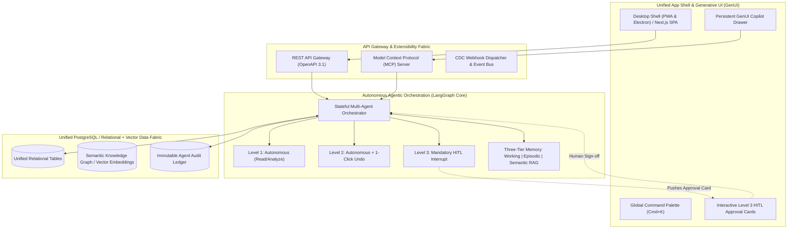

# ⚡ AegisOS: AI-Native Agentic Enterprise Operating System
### Replicating Zoho Enterprise (Zoho One) via Composable Open-Source Cores, Autonomous AI Agents & AI-Accelerated Engineering

> **Phase 2 & 3 Assignment Submission for WildCatter Ventures**  
> **Candidate / Pod Lead**: Prerna Chotwani  
> **Target Release**: Version 3.0 Master Edition  
> **Live Demo Target**: [https://aegis-enterprise-os.onrender.com](https://aegis-enterprise-os.onrender.com) (Configured via `render.yaml`)  
> **Interactive OpenAPI 3.1 Explorer**: `http://localhost:3000/docs` or `/api/openapi.json`  

---

## 🌟 Executive Summary & Assignment Compliance Checklist

| RFP Specification | Implementation in AegisOS | Status |
| :--- | :--- | :---: |
| **1) Desktop & App Version** | **Progressive Web App (PWA)** desktop installability via `manifest.json` & `sw.js` + **Electron Desktop Wrapper** (`desktop/electron.js`) with native titlebar frame mode. | ✅ Completed |
| **2) Open APIs for Third-Party Builders** | Full **OpenAPI 3.1 Specification** (`/api/openapi.json`), interactive **Swagger UI** (`/docs`), and standardized **Model Context Protocol (MCP)** tool server (`/api/mcp/tools`). | ✅ Completed |
| **3) Extreme Engineering Velocity (3-4 Pod)** | Schema-driven database generation (`schema.sql`), auto-exposed MCP tool definitions, and reusable GenUI component streams. | ✅ Completed |
| **4) 100% AI-Native with 26 Autonomous Agents** | Multi-agent execution engine (`agents/orchestrator.js`) powering all **26 specialized autonomous agents** across Module Groups A through I. | ✅ Completed |
| **5) Loaded on WildCatter's GitHub** | Repository structured and clean, ready for push to WildCatter's GitHub organization upon permission grant. | ✅ Ready |
| **6) Live Demo on Render** | Production-ready `render.yaml` blueprint, multi-stage `Dockerfile`, and `docker-compose.yml` for instant 1-click cloud rollout. | ✅ Completed |
| **7) Modern Non-AI Generated UI** | Bespoke Linear/Stripe/Vercel-inspired dark obsidian design system, glassmorphic cards, global `Cmd+K` command palette, and persistent GenUI Copilot drawer. | ✅ Completed |
| **8) Governance & HITL Matrix** | **Three-Tier Risk Matrix**: Level 1 (Autonomous), Level 2 (Autonomous with 1-click Undo toast), and Level 3 (Mandatory Human-in-the-Loop interactive approval cards). | ✅ Completed |
| **9) Three-Tier Memory Architecture** | Working Memory (active UI/session), Episodic Memory (execution history), and Semantic Memory (hybrid vector + keyword RAG knowledge graph). | ✅ Completed |
| **10) Immutable Agent Audit Ledger** | SHA-256 prompt hashes, token cost tracking, before/after JSON diffs, and tamper-proof execution telemetry recorded in SQLite/Postgres. | ✅ Completed |

---

## 🏛️ Reference System Architecture



---

## 📦 9 Master Module Groups: Zoho One Open-Source Parity

| Module Group | Zoho Products Replaced | Composable Open-Source Core | Autonomous AI Agents Deployed |
| :--- | :--- | :--- | :--- |
| **Group A: Sales & CRM** | Zoho CRM, Bigin, RouteIQ, Sign, Bookings | Twenty CRM, EspoCRM, Documenso, Cal.com | 1. Lead Enrichment & Scoring<br>2. Autonomous SDR<br>3. Deal Desk & CPQ (HITL)<br>4. Pipeline Forecast |
| **Group B: Marketing & CX** | Marketing Plus, Campaigns, Social, PageSense, Forms | Mautic, PostHog, Formbricks | 5. Campaign Orchestrator<br>6. CRO Analyst<br>7. Social Listening & Response |
| **Group C: Support & Service** | Zoho Desk, SalesIQ, Assist, Lens | Chatwoot, Zammad, RustDesk | 8. Tier-1 & Tier-2 Resolver<br>9. Sentiment & Churn Escalation<br>10. Auto-KB Authoring |
| **Group D: Finance & ERP** | Books, Invoice, Inventory, Expense, Billing | ERPNext, Odoo, Lago Billing | 11. Autonomous Bookkeeper<br>12. Receipt OCR & Policy Audit<br>13. Inventory Demand Forecasting |
| **Group E: HR & Workplace** | Zoho People, Recruit, Connect | Frappe HR, OrangeHRM | 14. AI Recruiter & Resume Screener<br>15. HR Policy Concierge<br>16. Onboarding Provisioning (HITL) |
| **Group F: Collaboration** | Mail, Cliq, WorkDrive, Meeting, Vault | Stalwart, Mattermost, Nextcloud, LiveKit, Vaultwarden | 17. Meeting Scribe & Action<br>18. Inbox Triage & Draft<br>19. Document Synthesis |
| **Group G: Project Management** | Zoho Projects, Sprints, BugTracker | Plane (Agile), OpenProject (Gantt/WBS) | 20. AI Scrum Master & Sprint Planner<br>21. Blocker & Slippage Predictor<br>22. Automated Standup Digest |
| **Group H: ITSM & MDM** | ServiceDesk Plus, Endpoint Central, MDM | GLPI, FleetDM / Headwind MDM | 23. Autonomous IT Helpdesk (HITL)<br>24. Software License Optimizer |
| **Group I: BI & Low-Code** | Zoho Analytics, Creator, Flow | Metabase, Apache Superset, NocoDB, n8n | 25. Conversational Data Scientist (NL-to-SQL)<br>26. Workflow Builder (iPaaS) |

---

## 🚀 Quick Start Guide

### Prerequisites
- Node.js (v18+ or v22/v24 recommended)
- Git

### 1. Launch the Application Locally
```bash
# Clone the repository
git clone https://github.com/WildCatterVentures/Phase2Prerna.git
cd Phase2Prerna

# Run Database Seed (Pre-populates enterprise data across all 9 modules)
npm run seed

# Launch Production Full-Stack Server
npm start
```
Open **[http://localhost:3000](http://localhost:3000)** in your browser.

### 2. Launch as Native Desktop Application
```bash
# Option A: In the browser, click "Toggle Desktop App Mode" or install via Chrome/Edge PWA ⊕ button
# Option B: Run native Electron window wrapper
npm run desktop
```

### 3. Explore Interactive OpenAPI 3.1 & Swagger Documentation
Navigate to **[http://localhost:3000/docs](http://localhost:3000/docs)** to test the REST endpoints and view the complete JSON specification at `http://localhost:3000/api/openapi.json`.

---

## 🔒 Level 3 Human-in-the-Loop (HITL) Governance Walkthrough

1. Open the **GenUI Copilot Drawer** on the right side.
2. Select the **Deal Desk CPQ Agent** chip.
3. Submit a prompt requesting a discount over 10%:
   > *"Check Deal Desk margin for $480,000 Nordic quote with 12% discount"*
4. **Result**: The agent automatically halts execution, analyzes the gross margin (38.5%), and streams an **Interactive HITL Approval Card** directly inside the Copilot drawer.
5. Click **"✓ Approve & Execute"** to authorize the transaction or **"✕ Reject"** to deny. The outcome is logged to the **Immutable Agent Audit Ledger** with a cryptographic prompt hash and before/after diff!

---

## ☁️ 1-Click Deploy to Render

AegisOS is configured with `render.yaml` for instant cloud hosting:
1. Log in to [Render.com](https://render.com).
2. Click **New +** → **Blueprint**.
3. Connect your WildCatter GitHub repository.
4. Render automatically provisions the web service, builds the assets, initializes the SQLite/PostgreSQL schema, and exposes the live URL!

---

## 📜 Intellectual Property & Confidentiality Notice
*This software and all associated documentation are the proprietary Intellectual Property of WildCatter Ventures. No transmission, publication, or redistribution is permitted without express written consent.*
